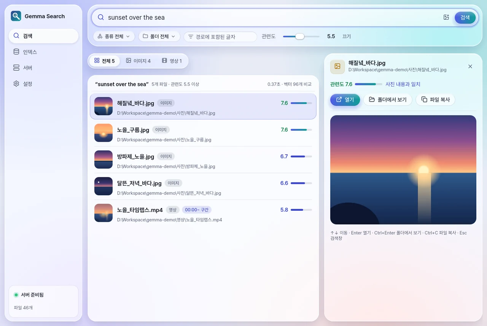
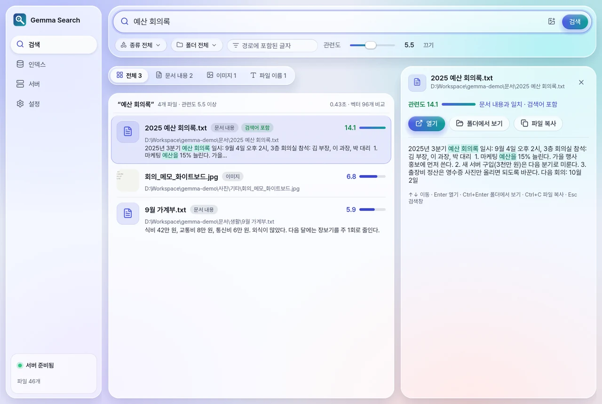
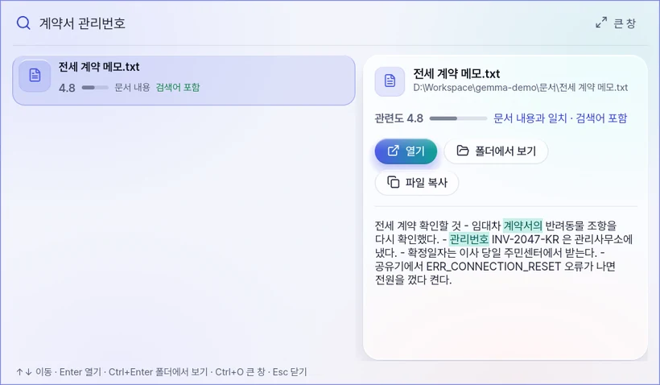
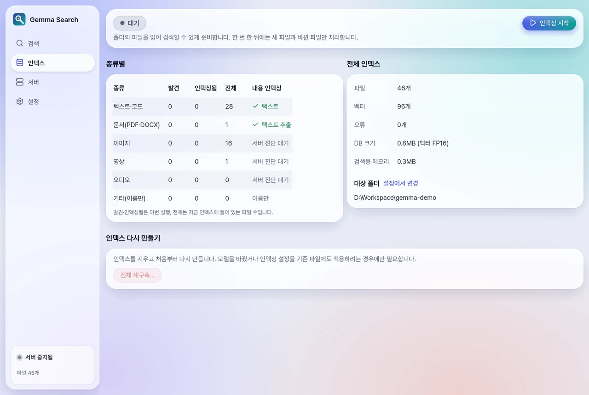
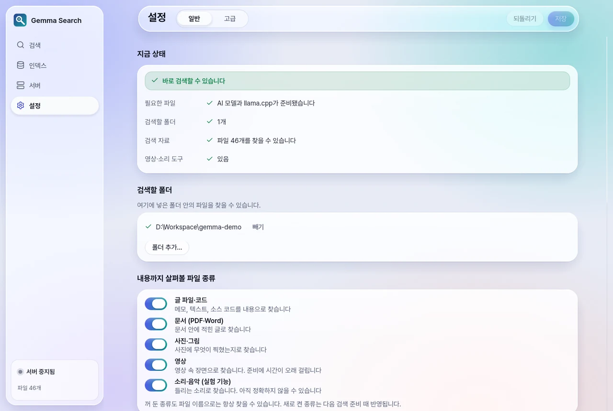
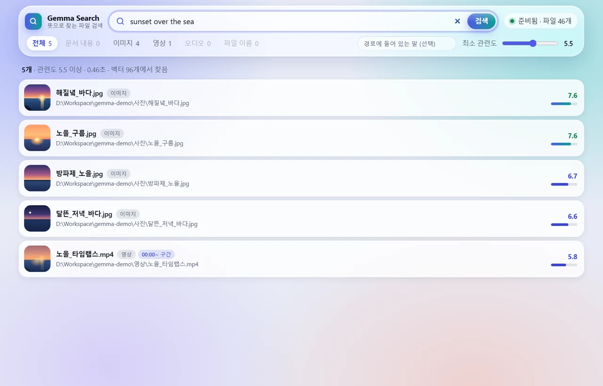
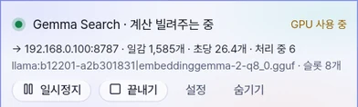

<p align="center"></p>

# Gemma Search

> Local semantic file search for Windows. Finds documents, code, PDFs, photos, video and audio by meaning, fully offline, using Google's EmbeddingGemma 2 on llama.cpp. A headless build runs on Linux servers.

PC에 있는 문서·사진·영상·소리를 뜻으로 찾는 Windows 프로그램입니다. "바다가 보이는 사진", "예산 회의록"처럼 말로 적거나 사진을 창에 끌어다 놓으면 찾습니다. 임베딩 모델(EmbeddingGemma 2)과 llama.cpp가 PC 안에서 돌기 때문에 파일 내용이 밖으로 나가지 않습니다.

<picture>
  <source media="(prefers-color-scheme: dark)" srcset="docs/screenshots/search-dark.webp">
  
</picture>

## 설치

1. [Releases](https://github.com/kimbad1992/gemma-desktop-search/releases)에서 zip을 받아 아무 폴더에 풀고 `gemma-search.exe`를 실행합니다. 코드 서명이 없어서 처음에 SmartScreen 경고가 뜨면 "추가 정보 → 실행"을 누릅니다.
2. 처음 설정 마법사가 그래픽카드와 메모리를 확인하고, 이 PC에 맞는 llama.cpp(CUDA 13·CUDA 12·Vulkan·CPU)와 모델(865MB)을 받습니다.
3. 검색할 폴더를 고르고 완료를 누르면 인덱싱이 시작됩니다.

- 영상·소리·HEIC 사진까지 읽으려면 ffmpeg가 있어야 합니다. 마법사에 winget 설치 버튼이 있습니다.
- 설정과 인덱스는 `%LOCALAPPDATA%\GemmaSearch`에 둡니다. 새 버전을 다른 폴더에 풀어도 같은 인덱스를 씁니다. v0.8.0까지 실행 파일 옆에 쌓인 데이터는 처음 실행할 때 옮길지 묻고, 계속 실행 파일 옆에 두려면 그 옆에 `portable.txt`를 만듭니다.
- 새 버전이 나오면 왼쪽 메뉴 아래에 "업데이트 가능"이 뜨고, 누르면 받아서 바꾼 뒤 다시 시작합니다. 이전 실행 파일은 `gemma-search.old.exe`로 남습니다.

## 기능

### 뜻으로 찾기

맨 위 화면은 영어로 "sunset over the sea"를 찾은 결과입니다. 파일 이름이 한글이어도 사진 내용으로 찾아냈고, 영상은 맞은 구간까지 알려 줍니다.

- 한국어와 영어 모두 됩니다. 사진을 창에 끌어다 놓거나 검색창의 그림 버튼으로 고르면 비슷한 사진과 영상을 찾습니다.
- 결과를 고르면 오른쪽에 크게 보입니다. 사진은 원본, 영상은 맞은 장면, 문서는 맞은 구간이 나옵니다.
- Enter로 열면 영상·소리는 그 시점에서, PDF는 그 쪽에서 열립니다(VLC, mpv, 팟플레이어, Edge, Chrome, SumatraPDF 등).
- 관련도는 이 검색에서 다른 파일보다 얼마나 두드러지는지를 나타냅니다. 7 이상이면 뚜렷하게 맞고, 기본값 5.5보다 낮으면 숨깁니다. 그래서 맞는 파일이 없으면 결과가 비어 나옵니다.

### 문서 본문과 정확한 단어

<picture>
  <source media="(prefers-color-scheme: dark)" srcset="docs/screenshots/docs-dark.webp">
  
</picture>

- 텍스트·코드·PDF·Word 문서의 본문을 읽습니다. PDF는 몇 쪽에서 맞았는지 나옵니다.
- 송장 번호, 오류 코드, 사람 이름처럼 글자가 그대로 맞아야 하는 단어는 키워드 색인으로도 찾습니다. 검색어가 모두 들어 있는 파일에는 "검색어 포함"이 붙고, 관련도가 낮아도 보입니다.
- 조사를 떼고 찾습니다. "회의록을"로 검색해도 "회의록"이 든 파일이 나옵니다.
- 종류·폴더·경로로 거르거나 "이미지", "영상" 같은 탭으로 나눠 볼 수 있습니다.

### 빠른 검색창

<picture>
  <source media="(prefers-color-scheme: dark)" srcset="docs/screenshots/quick-dark.webp">
  
</picture>

- 앱이 켜져 있으면 어느 프로그램에서든 Ctrl+Shift+Space로 작은 검색창이 뜹니다. 입력하는 대로 찾습니다.
- 창을 닫아도 앱은 트레이에 남습니다. 설정에서 "컴퓨터를 켜면 자동으로 시작"을 켜면 로그인할 때 트레이로 시작합니다.

| 키 | 동작 |
|---|---|
| Ctrl+Shift+Space | 빠른 검색창 띄우기 |
| ↑ ↓ | 결과 사이 이동 |
| Enter | 열기 (영상·소리는 맞은 시점, PDF는 맞은 쪽) |
| Ctrl+Enter | 탐색기에서 보기 |
| Ctrl+C | 파일 복사 (탐색기나 메신저에 붙여넣기) |
| Ctrl+O | 빠른 검색창의 검색을 큰 창에서 |
| Esc | 검색창으로, 빠른 검색창은 닫기 |

### 인덱싱과 폴더 감시

<picture>
  <source media="(prefers-color-scheme: dark)" srcset="docs/screenshots/index-dark.webp">
  
</picture>

- 처음 한 번 폴더 전체를 읽고, 그 뒤로는 바뀐 파일만 다시 읽습니다.
- 폴더 감시를 켜면 파일이 생기거나 바뀌는 대로 그 파일만 반영합니다. 변경 알림이 오지 않는 NAS 폴더는 6시간마다 훑어서 찾습니다.
- 인덱싱 중에 창을 보고 있지 않으면 화면 오른쪽 아래 작은 창에 진행률이 나옵니다. 전체 화면 게임이나 영상을 보는 동안에는 숨습니다.
- 검색 서버(llama-server)는 필요할 때 켜고, 10분 동안 쓰지 않으면 꺼서 그래픽 메모리를 돌려줍니다.
- 키·인증서·비밀번호 파일(`.pem`, `.kdbx`, `.env` 등)은 내용을 읽지 않습니다.

### 설정

<picture>
  <source media="(prefers-color-scheme: dark)" srcset="docs/screenshots/settings-dark.webp">
  
</picture>

- "일반" 화면 맨 위에 지금 바로 검색할 수 있는지가 나오고, 빠진 것이 있으면 해결 버튼이 붙습니다.
- 내용까지 읽을 파일 종류를 고릅니다. 끈 종류는 파일 이름으로만 찾습니다.
- "고급" 화면에서는 llama.cpp 경로, 서버 옵션(`-ngl`, `-c`, `-ub` 등), 인덱싱 세부값을 바꿉니다.
- 화면은 Windows의 밝은·어두운 테마를 따릅니다.

### 브라우저 검색 페이지

<picture>
  <source media="(prefers-color-scheme: dark)" srcset="docs/screenshots/web-dark.webp">
  
</picture>

창 없는 서비스판(`gemma-search serve`)이 폴더를 감시하고 인덱싱하면서 검색 페이지를 엽니다. 다른 PC나 휴대폰 브라우저로 찾고, 사진·영상·소리·PDF를 바로 미리 봅니다. 인터넷 연결 없이도 뜹니다. Linux 서버에서 쓰는 방법은 [아래](#linux-서버에서-쓰기)에 있습니다.

### 여러 PC의 그래픽 나눠 쓰기

<picture>
  <source media="(prefers-color-scheme: dark)" srcset="docs/screenshots/lend-dark.webp">
  
</picture>

파일이 있는 PC가 인덱싱하는 동안 그래픽이 좋은 다른 PC가 임베딩 일감을 가져가 처리합니다. 내장 그래픽 미니 PC 혼자 25분 걸린 사진 1,752장을, 같은 집의 RTX 4090이 거들자 2분 만에 끝냈습니다.

1. 파일이 있는 PC에서 서비스를 네트워크에 엽니다: `gemma-search serve --bind 0.0.0.0:8787`. 시작할 때 접속 토큰이 출력됩니다.
2. 빌려줄 PC에서 시작합니다. Windows 앱은 트레이 메뉴의 "계산 빌려주기 시작"(주소와 토큰은 설정 → 고급), Linux는 `GEMMA_SEARCH_TOKEN=<토큰> gemma-search lend --server http://<파일이 있는 PC>:8787`.

- 두 PC의 llama.cpp 빌드와 모델 파일이 같아야 합니다. CUDA판과 Vulkan판처럼 백엔드만 다른 것은 괜찮습니다.
- 빌려주는 PC가 꺼지면 맡긴 일감을 15초쯤 뒤에 다시 나눠 주므로 인덱싱이 멈추지 않습니다.
- 파일 내용이 오가는데 암호화하지 않습니다. 집 LAN이나 Tailscale 같은 VPN 안에서만 씁니다.

## 지원 형식

| 종류 | 확장자 | 읽는 방식 |
|---|---|---|
| 텍스트·코드 | txt, md, csv, json, py, rs, js, ts, c/cpp 등 | UTF-8·UTF-16·CP949 자동 판별 |
| 문서 | pdf, docx | 본문 추출, PDF는 쪽 단위 (스캔 PDF는 이름만) |
| 사진 | jpg, png, webp, bmp, gif, tiff, heic·avif(ffmpeg) | 사진 내용 |
| 영상 | mp4, mkv, mov, avi, webm 등 | 30초 구간의 화면과 소리 |
| 소리 | mp3, wav, flac, m4a, ogg 등 | 30초씩 겹쳐서 |
| 그 밖 | 모든 파일 | 파일 이름 |

아직 안 되는 것: HWP·HWPX, PPTX·XLSX, 스캔 문서 OCR.

## Linux 서버에서 쓰기

화면 없는 서버나 NAS에서 폴더를 감시하고 인덱싱합니다. Linux x64, glibc 2.34 이상(Ubuntu 22.04 이상)에서 돌고, 관리자 권한(sudo) 없이 한 계정 안에서 설치합니다.

```bash
mkdir -p ~/gemma-search && tar -xzf gemma-desktop-search-vX.Y.Z-linux-x64.tar.gz -C ~/gemma-search && cd ~/gemma-search
./gemma-search download                              # 이 기기에 맞는 llama.cpp와 모델 받기
./gemma-search serve --root ~/문서 --root /mnt/nas/사진
```

`serve`에 준 값은 설정에 저장되므로 다음부터는 `./gemma-search serve`만 쓰면 됩니다. 다른 터미널에서 상태를 보고 검색합니다.

| 명령 | 하는 일 |
|---|---|
| `status` | 서버·인덱스·인덱싱 진행·폴더 감시 상태 |
| `search <질의…>` | 검색. `--kinds docs,images`, `--path <글자>`, `--min <관련도>`, `--json` |
| `index [--rebuild] [--wait]` | 바뀐 파일을 지금 인덱싱. `--rebuild`는 처음부터 |
| `rescan` | 폴더를 지금 훑어 바뀐 파일 찾기 |
| `lend --server <주소>` | 다른 기기의 인덱싱을 이 기기 그래픽으로 거들기 |
| `update [--restart]` | 새 버전으로 바꾸기. `--restart`는 서비스까지 다시 띄움 |
| `data` | 데이터 위치 보기, 옮기기 |

- 검색 페이지는 기본으로 그 기기에서만 열립니다(`127.0.0.1:8787`). 다른 PC에서는 `ssh -L 8787:localhost:8787 <서버>`로 터널을 열고 http://localhost:8787 을 엽니다.
- `--bind 0.0.0.0:8787`로 네트워크에 열면 접속 토큰을 확인합니다. HTTPS가 아니므로 믿을 수 있는 내부망에서만 엽니다.
- `download`는 NVIDIA면 CUDA판, Vulkan을 쓸 수 있으면 Vulkan판, 아니면 CPU판을 고릅니다. 내장 그래픽이라도 Vulkan판이 CPU판보다 5배쯤 빠릅니다.

계속 띄워 두려면 systemd 사용자 서비스로 등록합니다(sudo 없이). `~/.config/systemd/user/gemma-search.service`:

```ini
[Unit]
Description=Gemma Search

[Service]
ExecStart=%h/gemma-search/gemma-search serve
Restart=on-failure

[Install]
WantedBy=default.target
```

```bash
systemctl --user enable --now gemma-search
```

로그아웃한 뒤에도 돌게 하려면 `loginctl enable-linger`를 한 번 실행합니다.

## 빌드

```
cargo build --release                          # 창 있는 앱 (Windows)
cargo build --release --no-default-features    # 창 없는 서비스판 (Linux, Windows)
cargo test --release
```

- Windows: Rust(stable, MSVC), Visual Studio C++ 빌드 도구
- Linux: Rust(stable)와 gcc(Ubuntu는 `build-essential`)
- 릴리스의 Linux판은 GitHub Actions([`.github/workflows/linux.yml`](.github/workflows/linux.yml))가 Ubuntu 22.04에서 빌드해 붙입니다.

## 참고한 프로젝트

[DigUp](https://github.com/ARahim3/DigUp)(MIT, Abdur Rahim)에서 의미 검색에 키워드 검색(FTS5)을 더하는 방식, 오디오 창을 겹치는 방식, 맞은 시점·쪽에서 여는 방식, 전역 단축키 검색창, 점수로 "맞는 게 없음"을 알리는 방식 등을 가져왔습니다. 코드는 새로 썼습니다. 영상은 장면마다 정지 화면을 쓰는 DigUp과 달리 모델 카드대로 30초 구간을 영상 그대로 임베딩합니다.

## 라이선스

[MIT](LICENSE)

- EmbeddingGemma 2 모델 가중치는 이 저장소에 없고, 모델의 라이선스를 따릅니다.
- 화면 글꼴 [Pretendard](https://github.com/orioncactus/pretendard) v1.3.9(Kil Hyung-jin)를 실행 파일에 넣었습니다. [SIL Open Font License 1.1](assets/fonts/Pretendard-LICENSE.txt)을 따릅니다.
- 아이콘 글꼴 [Lucide](https://lucide.dev)를 실행 파일에 넣었습니다. [ISC License](assets/fonts/Lucide-LICENSE.txt)를 따르고, Feather에서 온 일부 아이콘은 MIT License를 따릅니다.
