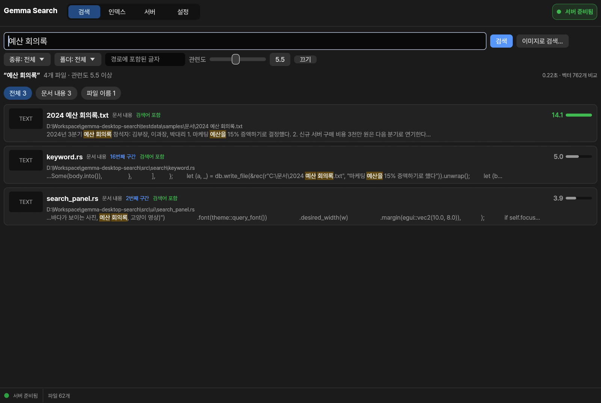
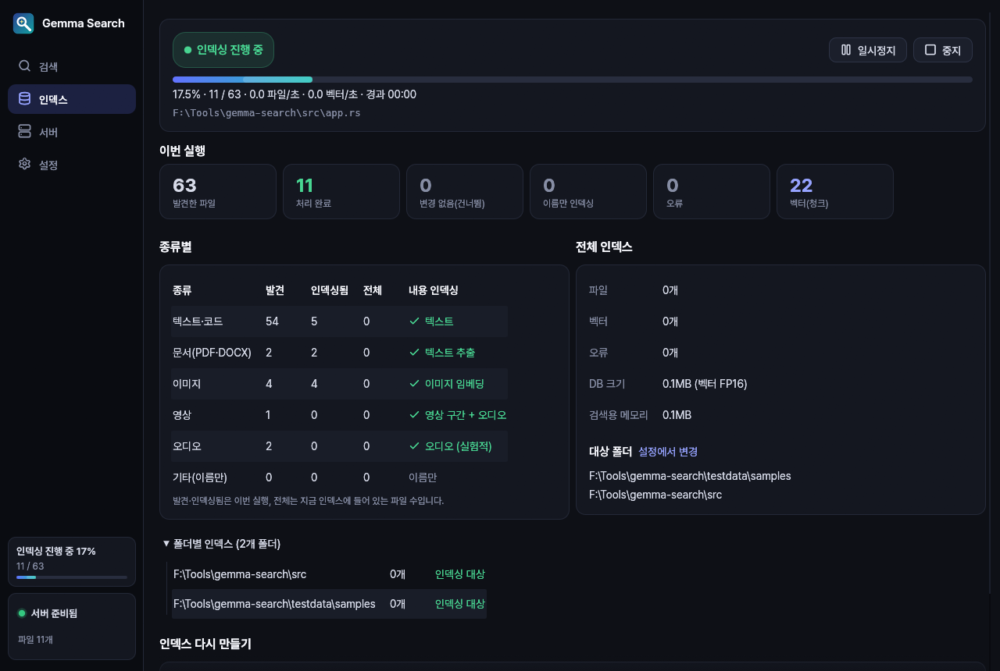
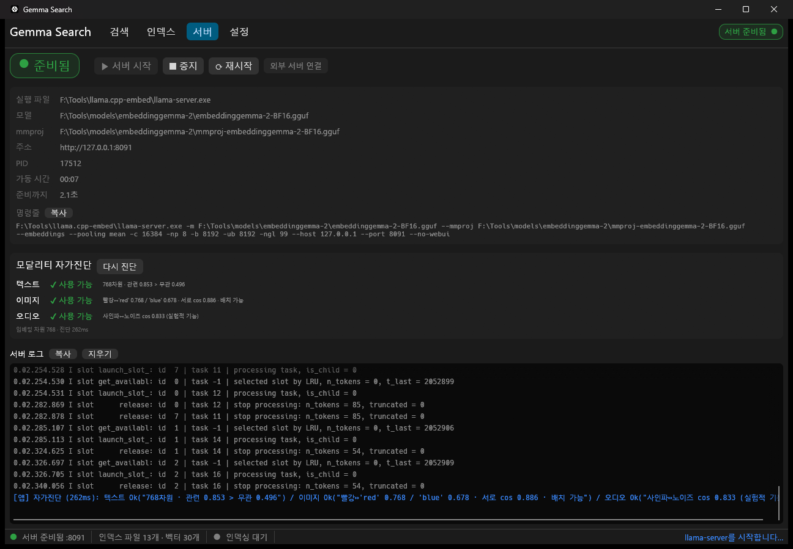
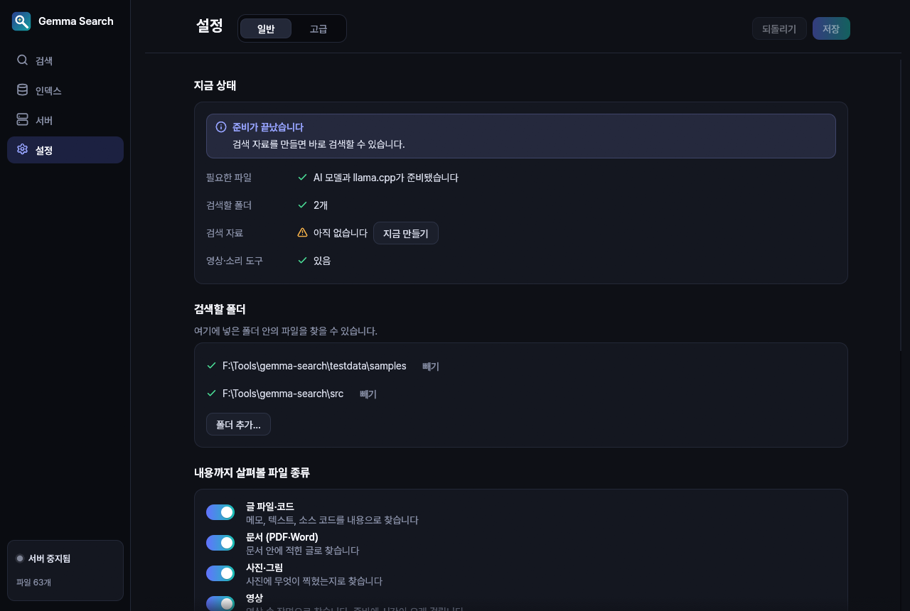

<p align="center"></p>

# Gemma Search

> Local multimodal semantic file search for Windows — Rust + egui GUI on top of Google's **EmbeddingGemma 2** running in **llama.cpp**. Search documents, code, PDFs, photos, video and audio by meaning, fully offline. A headless service build runs on Linux servers.

EmbeddingGemma 2와 llama.cpp로 만든 Windows용 **로컬 의미 검색기**(Rust, egui)입니다.
문서·코드·PDF·DOCX·사진·영상·오디오를 하나의 768차원 공간에 임베딩해서, 자연어나 이미지로 검색합니다.
모든 처리는 PC 안에서 이뤄지고, 외부로 전송되는 데이터는 없습니다.

화면 없는 Linux 서버에서 도는 **서비스판**도 있습니다. 서버가 폴더를 감시하고 인덱싱하며, 검색은 명령줄이나 다른 PC의 브라우저로 합니다. [Linux 서버에서 쓰기](#linux-서버에서-쓰기-서비스판)를 보세요.

| 검색 | 인덱싱 진행 상태 | 서버 관리·자가진단 |
|---|---|---|
|  |  |  |

## 준비물

**설정 탭 → 일반 → 지금 상태**의 "필요한 것 모두 받기"를 누르면 모델과 llama.cpp를 [데이터 위치](#데이터-위치) 아래(`models\`, `llama.cpp\`)로 바로 받습니다. 체크섬을 확인하고, 끊기면 이어서 받습니다. 새 버전을 다른 폴더에 풀어도 받은 것을 그대로 씁니다.
- 모델: EmbeddingGemma 2 Q8 (865MB)
- llama.cpp: 검증한 빌드 b12201로 고정. CUDA 13 / CUDA 12 / Vulkan / CPU 중에서 이 PC에 맞는 판을 골라 줍니다. 직접 고르려면 **설정 → 고급 → 준비물 받기 (수동)**을 쓰세요.

직접 받으려면 다음 표를 보세요.

| 항목 | 받는 곳 | 비고 |
|---|---|---|
| llama.cpp (Windows 빌드) | [ggml-org/llama.cpp releases](https://github.com/ggml-org/llama.cpp/releases) | `gemma-embedding2`를 지원하는 b11457 이상. NVIDIA GPU라면 `llama-bXXXX-bin-win-cuda-*-x64.zip`과 `cudart-llama-bin-win-cuda-*-x64.zip`을 같은 폴더에 풉니다 |
| EmbeddingGemma 2 GGUF | [ggml-org/embeddinggemma-2-GGUF](https://huggingface.co/ggml-org/embeddinggemma-2-GGUF) | 기본은 `embeddinggemma-2-Q8_0.gguf`(310MB)와 이미지·오디오용 `mmproj-embeddinggemma-2-Q8_0.gguf`(555MB). BF16도 됩니다. fp16은 쓰지 마세요(모델 카드 경고) |
| ffmpeg / ffprobe | `winget install Gyan.FFmpeg` 등 | 선택 사항. 영상·오디오·HEIC 인덱싱에 필요 |

기본 경로는 데이터 위치 아래 `llama.cpp\`와 `models\embeddinggemma-2\`입니다. 다른 곳에 두었다면 **설정 → 고급 → llama.cpp 서버 · 경로**에서 바꾸면 됩니다.

## 실행

[Releases](https://github.com/kimbad1992/gemma-desktop-search/releases)에서 zip을 받아 원하는 폴더에 풀고 `gemma-search.exe`를 실행합니다. 직접 빌드하는 방법은 아래 [빌드](#빌드)에 있습니다.

- exe는 코드 서명이 되어 있지 않습니다. 처음 실행할 때 Windows SmartScreen이 "PC 보호" 경고를 띄우면 **추가 정보 → 실행**을 누르세요.

- 설정·인덱스와 앱이 받은 준비물은 사용자 폴더의 한곳([데이터 위치](#데이터-위치))에 둡니다. 새 버전을 다른 폴더에 풀어도 같은 인덱스를 씁니다.

### 데이터 위치

| OS | 위치 |
|---|---|
| Windows | `%LOCALAPPDATA%\GemmaSearch` (예: `C:\Users\<이름>\AppData\Local\GemmaSearch`) |
| Linux | `$XDG_DATA_HOME/gemma-search` (보통 `~/.local/share/gemma-search`) |
| macOS | `~/Library/Application Support/GemmaSearch` |

- 그 안에 `data\`(설정 `config.toml`, 인덱스 `index.db`, 로그)와 앱이 받은 준비물(`llama.cpp\`, `models\`)이 있습니다. 인덱스가 크고 PC마다 다르므로 Roaming이 아닌 Local에 둡니다.
- **다른 드라이브로 옮기기**: **설정 → 일반 → 데이터 위치**의 "다른 곳으로 옮기기"로 폴더를 고릅니다. 고른 폴더가 비어 있지 않으면 그 아래 `GemmaSearch` 폴더로 옮깁니다. 기본 위치에는 옮긴 곳을 적은 `location.txt`만 남습니다.
- **예전 버전(v0.8.0까지)의 데이터**: 예전 버전은 exe 옆 `data\`에 저장했습니다.
  - 예전 폴더에서 새 버전을 실행하면(앱 안 업데이트 포함) 처음 한 번 옮길지 묻습니다. "옮기기"를 고르면 `data\`와, 설정이 가리키는 그 폴더의 `llama.cpp\`·`models\`를 함께 옮기고 설정의 경로도 고칩니다. 직접 지정한 다른 곳의 경로는 그대로 둡니다.
  - 새 폴더에 풀었다면 처음 설정 화면이나 **설정 → 일반 → 데이터 위치**의 "예전 데이터 가져오기"로 예전 폴더(또는 그 `data` 폴더)를 고릅니다. 새 위치에 이미 인덱스가 있으면 지우지 않고 `data.before-import-<시각>`으로 이름을 바꿔 둡니다.
  - 같은 드라이브면 폴더 이름만 바꿔 바로 옮깁니다. 다른 드라이브면 복사한 뒤 새 위치에서 인덱스가 열리고 파일 수가 같은지 확인하고 원래 것을 지웁니다. 설정에서 옮기면 앱이 다시 시작하면서 옮깁니다.
- **포터블로 쓰기**: exe 옆에 `portable.txt`를 두면 예전처럼 exe 옆의 `data\`와 준비물을 씁니다. 옮길지 묻는 화면에서 "이 폴더에서 계속 쓰기"를 고르면 이 파일이 생깁니다.
- `cargo run`이나 `target\release\gemma-search.exe`로 실행해도 같은 위치를 씁니다. 이때 "exe 옆"은 프로젝트 루트입니다.
- 환경 변수 `GEMMA_SEARCH_DATA`를 주면 데이터 폴더만 그곳을 씁니다 (시험용).
- 명령줄: `gemma-search data`(지금 위치), `data move`(exe 옆의 예전 데이터를 옮기기), `data move-to <폴더>`, `data import <폴더>`. 옮기는 동안에는 앱과 서비스를 꺼 둡니다.

## 처음 사용 순서

zip을 풀고 `gemma-search.exe`를 실행하면 **처음 설정 마법사**가 뜹니다. 설치 없이 바로 쓰고, 마법사는 처음 한 번만 뜹니다. 설정 탭의 "처음 설정 다시 열기"로 다시 열 수 있습니다.

1. **PC 확인**: 다음을 확인해 ✔/⚠/✖로 보여줍니다.
   - Windows 버전, 메모리
   - 그래픽카드(VRAM, NVIDIA 드라이버 버전)
   - 남은 디스크 공간
   - ffmpeg 유무
2. **필요한 파일 준비**: 사양에 맞는 llama.cpp 판을 골라 줍니다.
   - NVIDIA 드라이버 580 이상: CUDA 13
   - NVIDIA 드라이버 551 이상: CUDA 12
   - AMD·Intel 그래픽: Vulkan
   - 그래픽카드가 없거나 VRAM이 부족하면: CPU
   - "필요한 것 모두 받기"를 누르면 모델과 llama.cpp를 데이터 위치 아래로 받습니다. ffmpeg는 winget 설치 버튼을 누르면 됩니다.
   - 이미 받아 둔 llama.cpp 폴더와 모델 파일(.gguf)이 있으면 "위치 직접 지정"을 펼쳐 그대로 쓸 수 있습니다. 고르면 llama.cpp를 실제로 실행해 보고(버전 확인) 모델 파일의 종류를 읽어, 쓸 수 있으면 ✔로 알려 줍니다. llama.cpp(llama-server)만 지원하고 vLLM·Ollama 같은 다른 서버는 쓸 수 없습니다.
3. **이 PC에 맞추기**: VRAM에 맞춰 입력 크기를 정합니다. 실측 VRAM은 다음과 같습니다.
   - `-ub 8192`: 3.6GB (VRAM 6GB 이상일 때)
   - `-ub 4096`: 2.1GB
   - `-ub 2048`: 1.7GB
4. **검색할 폴더**를 고릅니다.
5. **동작 확인 (선택)**: 서버를 켜고 텍스트·이미지·오디오 임베딩을 시험합니다.
6. **완료**를 누르면 바로 인덱싱을 시작합니다("끝나면 바로 검색 준비 시작"을 끄면 시작하지 않습니다).

예전 버전에서 쓰던 설정(모델·llama.cpp·폴더가 다 있음)이면 마법사 없이 바로 시작합니다.

직접 설정하려면 다음 순서를 따릅니다.

1. **설정 → 고급**에서 세 경로를 지정합니다. llama.cpp는 실제로 실행해 보고 모델은 종류를 읽어, 쓸 수 있는지 ✔/✖로 바로 알려 줍니다.
   - llama.cpp: 폴더나 `llama-server.exe`
   - 모델 `.gguf`
   - mmproj `.gguf`: 이미지·오디오 임베딩에 필요합니다. 비워 두면 텍스트 전용으로 동작합니다.
2. **설정 → 일반 → 검색할 폴더**에서 폴더를 추가하고 **저장**합니다.
3. **서버** 화면에서 **서버 시작**을 누릅니다.
   - 서버가 준비되면 텍스트·이미지·오디오 자가진단이 자동으로 실행됩니다.
4. **인덱스** 화면에서 **인덱싱 시작**을 누릅니다. 서버가 꺼져 있으면 켜고 시작하므로 3번은 건너뛰어도 됩니다.
5. **검색** 화면에서 검색합니다.
   - 자연어 질의(한국어·영어)를 입력할 수 있습니다.
   - 송장 번호·오류 코드·이름 같은 정확한 단어도 함께 찾습니다.
   - 이미지를 창에 끌어다 놓으면 비슷한 이미지·영상을 찾습니다.
   - 앱이 켜져 있으면 어느 프로그램에서든 **Ctrl+Shift+Space**로 빠른 검색창을 불러올 수 있습니다.

## 설정 (일반 | 고급)

설정 탭은 두 화면으로 나뉩니다. **일반**만으로 충분히 쓸 수 있고, **고급**은 llama.cpp 옵션을 직접 다루려는 사람을 위한 화면입니다. 두 화면은 같은 설정을 고치므로, 어느 쪽에서 바꿔도 **저장** 한 번으로 함께 저장됩니다.

- **일반**
  - **지금 상태**: 바로 검색할 수 있는지, 아니면 무엇이 빠졌는지를 한 줄씩 보여주고 해결 버튼을 붙여 둡니다(필요한 것 모두 받기, 지금 만들기 등).
  - **검색할 폴더**: 폴더를 넣고 뺍니다.
  - **내용까지 살펴볼 파일 종류**: 글 파일·코드 / 문서(PDF·Word) / 사진·그림 / 영상 / 소리·음악. 끈 종류는 파일 이름으로만 찾습니다.
  - **성능**: "이 PC에 맞게 자동 설정"을 누르면 그래픽카드와 메모리를 확인해 추천값으로 맞춥니다(마법사 3단계와 같은 값).
  - **앱 동작**: 어디서든 빠른 검색, 창을 닫아도 계속 실행, 컴퓨터를 켜면 자동으로 시작, 켤 때 새 파일 자동 반영, 폴더 감시, 작업 중 작은 알림 창
  - **업데이트**: 지금 버전, "업데이트 확인"(새 버전이 있으면 받아서 바꾸고 다시 시작), 새 버전 알림
- **고급**
  - 준비물 받기(수동), llama.cpp 경로, 서버 옵션(포트, `-ngl`, `-c`, `-np`, `-b`, `-ub`, `-fa`, 추가 인자, 자동 시작·복구·끄기), 외부 도구(ffmpeg), 인덱싱 세부값(청크·구간·크기·작업 수·제외 폴더), 검색(검색 차원, 섹션별 최대 결과 수)
  - 서버가 켜진 뒤 서버 관련 값을 바꾸면 "다시 시작해야 적용됩니다" 안내와 다시 시작 버튼이 뜹니다.

화면은 Windows의 어두운/밝은 테마를 따릅니다.



## 상주 사용 (트레이 · 빠른 검색창)

- **트레이**: 창을 닫아도 끝나지 않고 트레이로 들어갑니다.
  - 아이콘을 클릭하면 창이 열립니다.
  - 우클릭 메뉴: 검색, 창 열기, 인덱싱 시작·일시정지·재개, 서버 시작·중지, 종료
  - 인덱싱 중에는 아이콘에 초록 점, 일시정지 중에는 주황 점이 붙습니다. 툴팁에 진행률이 나옵니다.
  - 트레이 아이콘을 만들지 못하면 왼쪽 메뉴 아래에 "상주 기능 제한"이 뜨고, 그동안은 창을 닫으면 숨기지 않고 앱을 끝냅니다(숨기면 다시 꺼낼 방법이 없으므로). 등록은 5초마다 다시 시도합니다.
  - UAC를 끈 PC에서 권한이 제한된 폴더(‘보통’ 무결성 레이블)에 프로그램을 두면 탐색기보다 낮은 권한으로 실행돼 트레이 아이콘을 만들 수 없습니다. 프로그램 폴더를 다른 드라이브로 옮기면 됩니다.
- **빠른 검색창 (Ctrl+Shift+Space)**: PowerToys Run처럼 화면 위쪽 가운데에 작은 창이 뜹니다.
  - 다른 프로그램이 같은 단축키를 쓰고 있으면 등록되지 않습니다. 그 프로그램이 놓으면 자동으로 등록합니다.
  - 입력하는 대로 검색하고, 결과는 종류와 상관없이 관련도 순으로 보여줍니다. 오른쪽에 미리보기가 나옵니다.
  - ↑↓ 이동, Enter 열기, Ctrl+Enter 폴더에서 보기, Esc 또는 다른 곳 클릭으로 닫기
  - Ctrl+O나 "큰 창"은 같은 검색을 큰 창에서 엽니다.
- **서버 자동 켜기·끄기**
  - 서버가 꺼져 있을 때 검색하면 자동으로 켜고, 준비되면(2초 안팎) 그 검색을 실행합니다.
  - 이렇게 앱이 켠 서버는 10분 동안 검색·인덱싱이 없으면 꺼서 VRAM을 돌려줍니다. 시간은 설정에서 바꿀 수 있습니다.
  - 서버 탭에서 직접 켠 서버는 끄지 않습니다.
- **인덱싱 오버레이**: 인덱싱 중인데 앱 창을 보고 있지 않으면 화면 오른쪽 아래에 작은 상태 창이 뜹니다.
  - 진행률, 남은 시간, 처리 중인 파일과 "GPU·CPU 사용 중"을 보여주고, 일시정지·중지·창 열기·숨기기 버튼이 있습니다.
  - 전체 화면 게임·영상·발표 중(Windows가 알림을 막는 상태)에는 자동으로 숨고, 포커스를 가져가지 않습니다.
  - ⚠ **주의**: 다른 창 위에 항상 떠 있는 창이라 창 모드 게임 위에 뜨거나, 일부 게임의 안티치트·화면 녹화·원격 데스크톱 프로그램과 충돌할 수 있습니다. 문제가 생기면 설정의 "작업 중 작은 알림 창"을 끄세요. 꺼도 트레이 아이콘(초록 점·툴팁)과 인덱스 탭에서 진행 상황을 볼 수 있습니다.
- **폴더 감시**: 설정에서 켜면, 검색 폴더의 파일이 생기거나 바뀌거나 지워질 때 그 파일만 다시 인덱싱합니다. 기본은 꺼져 있습니다.
  - 복사나 다운로드가 끝나 15초쯤 조용해진 뒤에 반영합니다. 계속 쓰이는 파일은 10분에 한 번만 반영합니다.
  - 옮기거나 이름만 바꾼 파일은 내용을 다시 읽지 않고 경로만 고칩니다. 이름·크기·수정 시각이 같고 옛 자리에 없는 파일을 옮긴 것으로 봅니다. 폴더째 옮기거나 이름을 바꿔도 마찬가지입니다.
  - 파일이 바뀌면 서버가 자동으로 켜지고 그래픽카드를 씁니다. 전체 화면 앱(게임·영상·발표)을 쓰는 동안은 미룹니다.
  - 켠 직후와 그 뒤 6시간마다(고급 설정에서 변경) 폴더를 훑어 인덱스와 비교합니다. 앱이 꺼져 있던 동안 바뀐 파일과 놓친 알림을 여기서 찾습니다. 서버 없이 크기와 수정 시각만 봅니다.
  - ⚠ **네트워크 폴더의 한계**: NAS에 따라 변경 알림이 오지 않거나 일부가 빠집니다. 그런 폴더는 주기적으로 훑을 때만 반영되므로 그 주기만큼 늦을 수 있습니다. 인덱스 화면의 "폴더 감시"에서 폴더별 상태를 볼 수 있고, "지금 확인"을 누르면 바로 훑습니다.
  - NAS에 연결할 수 없을 때는 그 폴더를 건너뜁니다. 그 아래 파일을 지워진 것으로 보지 않습니다.
- **로그인 시 실행**: 설정의 "컴퓨터를 켜면 자동으로 시작"을 켜면 Windows에 로그인할 때 트레이로 시작합니다.
  - `HKCU\Software\Microsoft\Windows\CurrentVersion\Run`에 등록됩니다.
  - exe를 옮기면 다음 실행 때 경로를 다시 맞춥니다.
  - "폴더 감시"를 함께 켜면 늘 최신 인덱스를 유지합니다.
- **한 번만 실행**: 이미 켜져 있을 때 다시 실행하면 새로 뜨지 않고 기존 창이 열립니다.
- **업데이트**: 새 버전이 나오면 앱 안에서 받아서 바꿉니다.
  - 하루 한 번 GitHub 릴리스를 확인하고, 새 버전이 있으면 왼쪽 메뉴 아래에 "업데이트 가능"을 띄웁니다. 파일 정보는 보내지 않고, 설정에서 끌 수 있습니다.
  - "업데이트 가능"이나 **설정 → 일반 → 업데이트**의 버튼을 누르면 새 버전이 있는지 확인하고, 있으면 받아서 실행 파일을 바꾼 뒤 다시 시작합니다.
  - 릴리스의 zip과 `.sha256` 파일을 받아 해시를 대조한 뒤에만 바꿉니다. zip에서는 `gemma-search.exe`만 꺼내고, `data\` 폴더는 건드리지 않습니다.
  - 이전 실행 파일은 `gemma-search.old.exe`로 남습니다. 문제가 생기면 이 파일을 `gemma-search.exe`로 되돌리면 됩니다.
  - 인덱싱 중이면 바꾸기만 하고 다시 시작하지 않습니다. 끝난 뒤 "다시 시작"을 누르면 적용됩니다.
  - 프로그램 폴더에 쓸 수 없으면 자동으로 바꾸지 못합니다. 그때는 릴리스 페이지 링크를 보여 줍니다.

## 상태 표시

| 색 | 서버 | 인덱싱 |
|---|---|---|
| 🟢 초록(깜빡임) | 준비됨 | 진행 중 |
| 🟡 노랑 | 시작 중 / 모델 로딩 | 일시정지 / 중지하는 중 |
| ⚪ 회색 | 중지됨 | 대기 / 중지됨 |
| 🔵 파랑 | – | 완료 |
| 🔴 빨강 | 오류 (원인 표시) | 오류 |

**인덱스 탭**
- 맨 위 카드: 상태와 그때 누를 버튼(시작 / 일시정지·중지 / 재개), 진행 막대, 그 아래 한 줄(%, 처리 수, 남은 시간, 속도)과 처리 중인 파일. 폴더 탐색 중에는 "폴더 탐색 중"으로 나오고, 탐색이 끝나면 %로 바뀝니다.
- 시작할 수 없을 때는 이유와 해결 버튼이 함께 나옵니다.
- 이번 실행: 발견한 파일 · 처리 완료 · 변경 없음 · 이름만 인덱싱 · 오류 · 벡터 수
- 종류별 표, 전체 인덱스 요약, 폴더별 인덱스와 오류 목록(접어 둠), 맨 아래 "전체 재구축"

**항상 보이는 표시**
- 왼쪽 메뉴: 검색 · 인덱스 · 서버 · 설정 화면을 오갑니다. 저장하지 않은 설정이 있으면 설정에 점이 붙습니다.
- 메뉴 맨 아래: 서버 상태와 검색할 수 있는 파일 수, 진행 중일 때 인덱싱 진행률. 누르면 그 화면이 열립니다. "업데이트 가능"과 "상주 기능 제한" 경고도 여기에 뜹니다.
- 창이 좁으면(폭 900 미만) 메뉴가 아이콘만 남고 상태는 점으로 보입니다. 마우스를 올리면 내용이 나옵니다.
- 알림: 오른쪽 아래에 잠깐 떴다 사라집니다(오류는 더 오래 남습니다).
- 창 제목: 진행률을 보여줍니다 (예: `[인덱싱 45%] Gemma Search`).

## 검색 결과

- **전체**: 파일 종류와 상관없이 관련도가 높은 순서로 한 줄로 보여줍니다. 같은 파일이 여러 폴더에 있으면 한 번만 나옵니다.
- 섹션 칩을 누르면 종류별로 볼 수 있습니다.

- **문서 내용**: 텍스트 청크. 일치한 부분의 스니펫이 표시되고, 검색어가 들어 있으면 강조됩니다. PDF는 몇 페이지인지 표시됩니다.
- **이미지**: 썸네일 그리드
- **영상**: 일치한 장면의 시각(예: `00:05 장면`). 오디오 트랙 구간도 포함됩니다.
- **오디오**: 일치한 구간 시작 시각
- **파일 이름**: 파일 이름과 경로
  - `IMG_0001`, `20170420_183051`, 해시처럼 뜻 없는 이름은 의미 비교에서 뺍니다. 이런 이름은 어떤 검색어에도 비슷한 점수가 나와 결과만 어지럽히기 때문입니다.
  - 이런 이름도 키워드로는 찾을 수 있습니다.

**관련도는 어떻게 계산하나**
- 임베딩의 코사인 유사도는 "몇 % 비슷하다"는 뜻이 아닙니다.
  - 상관없는 항목끼리도 0.5~0.6부터 시작하고, 잘 맞는 결과가 그보다 0.1~0.2 높은 정도입니다.
  - 그래서 다른 결과와 비교한 상대 순위로만 의미가 있습니다.
- 같은 질의에도 종류마다 점수대가 다릅니다. 실측 평균은 다음과 같습니다.

  | 종류 | 평균 |
  |---|---|
  | 문서 본문 | 0.52~0.59 |
  | 사진 | 0.55~0.60 |
  | 파일 이름 | 0.60~0.65 |
  | 오디오·영상 | 0.60~0.64 |

  이대로 섞으면 종류가 순위를 정합니다.
- **허브 보정**: 어떤 검색어에나 잘 걸리는 항목(밋밋한 스크린샷, 짧은 설정 파일 등)이 있습니다.
  - 흔한 주제의 기준 질의 119개와의 유사도 중앙값을 항목마다 재서 뺍니다. 종류별 점수대 차이도 함께 없어집니다.
  - 평균이 아니라 중앙값을 쓰는 이유: 반려동물 사진은 "강아지 산책" 같은 몇몇 질의와도 비슷해서, 평균을 쓰면 그 주제 사진이 통째로 깎입니다.
  - 기준 질의 벡터는 첫 검색 때 한 번 계산해 DB에 저장합니다.
- **관련도** = (보정한 점수 − 이 검색의 전체 중앙값) ÷ (1.4826 × MAD) + 검색어 가산점입니다.
  - MAD는 중앙값 절대 편차입니다. 이 검색에서 대부분의 파일보다 표준편차 몇 배만큼 높은지를 뜻하고, 마우스를 올리면 나눠서 보여줍니다.
  - 평균·표준편차 대신 중앙값·MAD를 쓰는 이유: 사진 대부분이 앵무새라면 "앵무새" 검색에 수천 장이 한꺼번에 높게 나옵니다. 평균·표준편차를 쓰면 그 덩어리 때문에 기준이 올라가, 내 사진에 많은 주제일수록 관련도가 낮아집니다. 실측으로 "indian ringneck parrot"이 4.0에서 10.3이 됐습니다.
- 실측(파일 6만여 개, 벡터 15만 개)
  - 맞는 파일이 없는 검색("효자손", "우주선 플랑크톤 경매", "qwxzv")의 1위: 4.4~4.9
  - 맞는 검색의 1위: 6.8~10.3 ("목도리앵무" 6.8, "고양이" 8.0, "생일 케이크" 9.2, "indian ringneck parrot" 10.3)
  - 그래서 최소 관련도 기본값 5.5에서는 맞는 게 없으면 결과가 비어 나옵니다.

**검색 폴더 선택**
- 검색 화면의 "폴더 전체" 목록에서 체크한 폴더 안에서만 검색합니다. 선택은 저장되고, 바꾸면 같은 질의로 바로 다시 검색합니다.
- 목록에는 지금 인덱싱 대상 폴더와, 예전에 인덱싱했다가 대상에서 뺀 폴더(기울임꼴)가 함께 나옵니다. 대상에서 빼도 그 폴더의 인덱스 결과는 남아 있습니다.
- 폴더 기록 기능 이전에 인덱싱해서 목록 어느 폴더에도 속하지 않는 항목은 "기타 위치"로 묶입니다.

**최소 관련도**
- 검색 탭의 슬라이더로 이 관련도 미만인 결과를 숨깁니다. 다시 검색하지 않고 바로 적용되고, 값은 자동으로 저장됩니다.
- 기본값은 5.5입니다. 대략 7 이상이면 뚜렷하게, 5.5 이상이면 관련 있는 결과입니다.
- 필터는 섹션마다 가져온 최대 결과 수(설정 → 고급의 "섹션별 최대 결과 수") 안에서 적용됩니다.

**정확한 단어 (키워드 검색)**
- 임베딩만으로는 송장 번호·오류 코드·이름을 정확히 담지 못합니다. 그래서 파일 이름·폴더 이름·문서 본문을 SQLite FTS5 키워드 색인에도 넣습니다.
- 검색어가 들어 있는 파일은 순위가 올라갑니다. 검색어가 **전부** 들어 있으면 "검색어 포함" 표시가 붙고, 최소 관련도보다 낮아도 보여줍니다. 일부만 들어 있으면 순위만 올라가고 최소 관련도는 그대로 적용됩니다.
- 검색어 가산점은 관련도 2 × 포함 비율^1.5입니다(DigUp과 같은 값). 번호·코드 조회형 질의는 4이고 의미 점수는 절반만 씁니다.
- "파일 이름" 섹션에는 이름·폴더 이름에 든 검색어만 반영합니다.
- 한국어 조사도 처리합니다. "계약서"로 "계약서에서"를 찾고, "회의록을"로 검색하면 "회의록"으로 찾습니다.
- "고양이 영상", "바다 사진"처럼 종류를 말하면 그 섹션을 먼저 보여줍니다.

**조작**

| 키 | 동작 |
|---|---|
| Ctrl+Shift+Space | 어느 앱에서든 빠른 검색창 띄우기 (설정에서 끌 수 있음) |
| ↓ ↑ | 결과 사이 이동 (검색창에서 ↓를 누르면 첫 결과로) |
| Enter | 열기: 영상·오디오는 일치한 시점, PDF는 그 페이지에서 |
| Ctrl+Enter | 탐색기에서 보기 |
| Ctrl+C | 파일 자체를 클립보드에 복사 (탐색기·메신저에 붙여넣기) |
| Esc | 검색창으로 |

- 결과를 클릭하면 오른쪽에 미리보기가 나옵니다. 사진은 크게 보이고, 영상은 일치한 장면이 보입니다. 문서는 일치한 구간 전체를 검색어 강조와 함께 보여줍니다.
- 일치한 시점·페이지로 여는 기능은 기본 앱이 위치를 받는 앱일 때 동작합니다.
  - 영상·오디오: VLC, mpv, MPC-HC/BE, 팟플레이어
  - PDF: Edge, Chrome, Firefox, Brave, 웨일, SumatraPDF, Acrobat
  - 그 밖의 앱은 파일을 처음부터 엽니다.

## 동작 방식

- **서버**
  - `llama-server --embeddings --pooling mean`을 콘솔 창 없이 직접 실행·중지합니다.
  - 서버는 Windows Job Object에 묶여 있어서, 앱이 비정상 종료돼도 함께 종료됩니다. Linux 서비스판에서는 서비스 프로세스가 끝나면 함께 끝나도록(`PR_SET_PDEATHSIG`) 띄웁니다.
- **접두사**: 모델 카드에 정의된 접두사를 텍스트에만 붙입니다.
  - 질의: `task: search result | query: …`
  - 문서: `title: 파일명 | text: …`
- **영상**: 모델 카드 방식대로 처리합니다.
  - 영상을 30초 구간으로 나누고, 구간마다 **영상 그대로**(`input_video`) 넣어 하나의 벡터로 임베딩합니다. 서버가 초당 1프레임으로 샘플링합니다(`--video-fps 1`).
  - 프레임 사이의 흐름까지 반영되고, 결과에는 "01:00~ 구간"처럼 위치가 표시됩니다.
  - 영상당 240구간(30초 구간이면 2시간)까지 끝까지 읽고, 그보다 길면 고르게 고릅니다. 설정에서 바꿀 수 있습니다.
  - 서버가 영상 입력을 받지 못할 때만 프레임 이미지 방식으로 대체합니다.
- **오디오**: 16kHz mono로 변환해 30초 창을 25초마다 겹쳐서 임베딩합니다. 문장이 두 창 사이에서 끊기지 않게 하려는 것입니다. 파일당 400창(약 2시간 45분)까지 읽습니다.
- **PDF**: 페이지마다 텍스트를 나눠 결과에 "N페이지"로 표시하고, 그 페이지에서 엽니다.
- **건너뛰는 파일**
  - 긴 변이 256px 미만인 이미지(아이콘·썸네일)와 2초 미만 소리는 이름만 넣습니다.
  - 키·인증서·비밀번호 파일(`.pem`, `.key`, `.kdbx`, `id_rsa`, `.env` 등)은 내용을 읽지 않습니다. `.ssh`, `.gnupg`, `.aws` 폴더는 아예 들어가지 않습니다.
- **증분 인덱싱**
  - 크기와 수정 시각이 같은 파일은 건너뜁니다. 지워진 파일은 인덱스에서 제거합니다.
  - 오류였던 파일은 다음 실행에서 다시 시도합니다.
- **이름만 인덱싱되는 경우**: 0바이트 빈 파일과 암호화된 PDF는 내용을 읽을 수 없습니다. 이런 파일은 오류로 세지 않고 "이름만"으로 분류합니다.
- **서버 충돌 자동 복구**
  - 인덱싱 중 llama-server가 비정상 종료되면 자동으로 다시 띄우고 변경분 인덱싱으로 이어갑니다(작업당 최대 5회).
  - 충돌 때 처리 중이던 파일을 기록해 두고, 같은 파일이 두 번 걸리면 그 파일의 내용 인덱싱은 건너뜁니다(이름만).
  - 이 기능은 설정에서 끌 수 있습니다.
- **서버 로그 파일**: 데이터 위치의 `data\logs\llama-server.log`에 남습니다. 20MB를 넘으면 `.old.log`로 교체됩니다.
- **Flash Attention은 기본으로 꺼 둡니다** (`-fa off`)
  - Windows 릴리스 빌드에서 RTX 40 계열 GPU로 Gemma 4 계열 모델과 mmproj를 쓰면, Flash Attention이 켜져 있을 때 llama-server가 `CUDA error: an illegal memory access`로 죽는 문제가 있습니다([llama.cpp #30436](https://github.com/ggml-org/llama.cpp/issues/30436)).
  - 이미지를 많이 인덱싱할 때 실제로 재현됐고, 꺼도 속도 차이는 거의 없었습니다. 설정에서 바꿀 수 있습니다.
- **FP16 저장**
  - 벡터를 절반 정밀도(FP16)로 저장해 DB 크기를 약 40% 줄입니다.
  - 실제 인덱스로 측정한 결과, 최대 점수 차이는 0.00007이었고 Top-10 순위는 20개 질의 모두 같았습니다.
  - 예전(FP32) 인덱스는 새 버전을 처음 실행할 때 자동으로 변환한 뒤 압축(VACUUM)합니다. 4만여 개 기준 수 초이고, 중간에 꺼져도 다음 실행 때 이어서 변환합니다.
- **차원**
  - DB에는 항상 768차원 원본을 저장합니다.
  - 검색 차원(768/512/256)은 설정에서 바꿀 수 있고, 바꿔도 재인덱싱이 필요 없습니다.
- **모델·llama.cpp를 바꿀 때 (호환성 검사)**
  - 모델 파일(BF16 ↔ Q8 등)이나 llama.cpp 빌드가 바뀌면, 다음 인덱싱을 시작할 때 기존 항목 일부(이름·텍스트·이미지·영상·오디오)를 다시 임베딩해 저장된 벡터와 비교합니다.
  - 벡터가 사실상 같으면(모든 종류에서 최소 코사인 0.99 이상, 평균 0.995 이상) 기존 인덱스를 그대로 씁니다. 다르면 **전체 재구축**을 요구합니다. 다른 벡터가 섞이면 검색이 틀어지기 때문입니다.
  - BF16 인덱스를 Q8 모델로 측정한 결과입니다.
    - 저장된 벡터와의 코사인: 평균 0.9998, 최소 0.9974(오디오)
    - 질의 22개의 섹션별 Top-10: 96~99%가 같았습니다.
- **포트**: Hyper-V/WSL이 재부팅 때마다 포트 범위를 예약해(예: 8067~8566) 설정 포트를 못 쓰게 되는 경우가 있습니다. 그러면 빈 포트(예: 18090)를 골라 서버를 띄우고, 그 포트를 설정에 저장합니다.

## 명령줄 옵션

```
gemma-search.exe --start-server          # 시작하면서 서버 실행
gemma-search.exe --index                 # 서버 준비 후 변경분 인덱싱 자동 시작
gemma-search.exe --query "회의록 예산"     # 서버 준비(및 인덱싱 완료) 후 검색
gemma-search.exe --tab index|server|settings|search
gemma-search.exe --headless-test <폴더> [질의...]   # GUI 없이 전체 흐름 점검 (개발용, 임시 DB 사용)
gemma-search.exe --bench <텍스트파일>              # 실행 중인 서버의 임베딩 처리량 측정
gemma-search.exe --index-once                      # 창 없이 변경분 인덱싱 한 번 (서버 시작·중지 포함, 앱이 같은 데이터 폴더로 떠 있으면 하지 않음)
gemma-search.exe --compat <포트나 주소>            # 인덱스 표본을 그 서버로 다시 임베딩해 벡터 비교
gemma-search.exe --sysinfo                         # 사양 확인과 추천 설정 (마법사와 같은 내용)
gemma-search.exe --check-update                    # 새 버전이 있는지 확인만
gemma-search.exe --update                          # 새 버전이 있으면 받아서 실행 파일을 바꿈 (창 없이)
gemma-search.exe --shot <png> [--tab …] [--theme light|dark] [--size 1280x860] [--query "질의"]
                                                   # 창을 띄우지 않고 화면을 그려 PNG로 저장 (개발용)
```

기본 서버 옵션은 `-c 65536 -np 8 -b 8192 -ub 8192 -fa off --video-fps 1`입니다.
- 슬롯당 8,192토큰(모델 최대 컨텍스트)이라 영상 30초 구간이 들어갑니다.
- 예전 기본값(`-c 16384`)을 그대로 쓰던 설정은 자동으로 옮겨집니다.
RTX 4090에서 측정한 처리량은 다음과 같고, 그중 가장 빨랐던 값을 기본으로 정했습니다.

| 설정 | 처리량 |
|---|---|
| `-np 4 -ub 2048` | 약 56 벡터/초 |
| `-np 8 -ub 8192` (기본값) | 약 91 벡터/초 |
| `-np 16` | 약 73 벡터/초 (GPU 포화) |

예: 로그인할 때 `--index`로 실행하면 인덱스를 늘 최신으로 유지할 수 있습니다.

서비스판 명령(`download`, `serve`, `status`, `search`, `index`, `rescan`)은 [Linux 서버에서 쓰기](#linux-서버에서-쓰기-서비스판)에 있습니다. Windows에서도 같은 명령을 쓸 수 있지만, 창 있는 빌드는 콘솔이 없어 출력이 보이지 않습니다. 명령줄로 쓰려면 서비스판으로 빌드하세요([빌드](#빌드)).

## Linux 서버에서 쓰기 (서비스판)

화면 없는 Linux 서버나 NAS에서 폴더를 감시하고 인덱싱합니다. 검색은 명령줄이나 다른 PC의 브라우저로 합니다. 인덱스 형식과 검색 방식은 창 있는 앱과 같습니다.

- Linux x64, glibc 2.34 이상(Ubuntu 22.04 이상 등)에서 돕니다.
- 관리자 권한(sudo) 없이 한 계정 안에서 설치하고 돌립니다. 프로그램이 시스템 폴더·패키지·그룹을 건드리지 않습니다.
- 릴리스를 올리면 GitHub Actions가 Linux판을 빌드해 `gemma-desktop-search-vX.Y.Z-linux-x64.tar.gz`(와 `.sha256`)로 함께 붙입니다. Linux판이 붙지 않은 예전 릴리스는 [빌드](#빌드)를 보고 직접 빌드하세요.

### 설치와 첫 실행

[Releases](https://github.com/kimbad1992/gemma-desktop-search/releases)에서 `…-linux-x64.tar.gz`를 받아 계정이 쓸 수 있는 폴더에 풀고, 준비물을 받은 뒤 서비스를 띄웁니다.

```bash
mkdir -p ~/gemma-search && tar -xzf gemma-desktop-search-vX.Y.Z-linux-x64.tar.gz -C ~/gemma-search && cd ~/gemma-search
./gemma-search download
./gemma-search serve --root ~/문서 --root /mnt/nas/사진
```

직접 빌드했다면 `target/release/gemma-search`를 `~/gemma-search`에 복사하면 됩니다.

다른 터미널에서 상태를 보고 검색합니다.

```bash
./gemma-search status
./gemma-search search 예산 회의록
```

- **`download`**: llama.cpp와 모델(865MB)을 데이터 위치(`~/.local/share/gemma-search`의 `llama.cpp/`, `models/`)로 받습니다.
  - 이 기기에 맞는 llama.cpp 판을 고릅니다. NVIDIA가 있으면 CUDA판, 그래픽을 Vulkan으로 쓸 수 있으면 Vulkan판, 아니면 CPU판입니다. 받을 것과 크기를 먼저 보여 주고 묻습니다.
  - SHA-256을 확인하고, 끊기면 다시 실행해 이어서 받습니다.
  - 판을 바꿀 때는 새 판을 옆 폴더에 다 푼 뒤 바꿔 넣으므로, 받다가 끊겨도 쓰던 llama.cpp는 그대로입니다. 이 명령으로 받지 않은 `llama.cpp/` 폴더는 지우지 않고 `llama.cpp.old-<시각>`으로 옮겨 둡니다.
  - 받은 위치는 설정에 적어 두므로 `serve`가 바로 찾습니다.
  - 옵션: `--list`(고를 수 있는 판과 이 기기의 추천), `--llama cpu|vulkan|cuda13|cuda12`(직접 고르기), `--only model|llama`, `--dir <폴더>`(받을 곳), `-y`(묻지 않기)
- **`serve`**: 서비스를 띄웁니다.
  - 옵션으로 준 값(`--root`, `--bind`, `--token`, `--llama`, `--model`, `--mmproj`, `--embed-server`, `--embed-key`)은 설정(`data/config.toml`)에 저장됩니다. 다음부터는 `./gemma-search serve`만 쓰면 됩니다.
  - 인덱스가 비어 있으면 바로 처음 인덱싱을 시작합니다. 폴더 감시는 기본으로 켜져 있습니다(`--no-watch`로 끔).
  - llama-server는 검색·인덱싱할 때 켜고, 10분 동안 쓰지 않으면 끕니다.
  - Ctrl+C나 SIGTERM으로 끝내면 llama-server도 함께 끝납니다. 서비스가 비정상 종료돼도 llama-server는 남지 않습니다.
  - 데이터 폴더는 `~/.local/share/gemma-search/data/`입니다(`./gemma-search data`로 확인). [데이터 위치](#데이터-위치)를 보세요.
  - 예전 버전처럼 실행 파일 옆에 `data/`가 있고 새 위치가 비어 있으면, 묻지 않고 실행 파일 옆을 그대로 쓰면서 옮기는 명령을 알려 줍니다. 서비스를 끄고 `./gemma-search data move`를 실행하면 옮깁니다(같은 디스크면 바로, 다른 디스크면 복사해 확인한 뒤).
  - 실행 파일 옆에 `portable.txt`를 두면 늘 실행 파일 옆의 `data/`를 씁니다. 환경 변수 `GEMMA_SEARCH_DATA`를 주면 데이터 폴더만 그곳을 씁니다.
  - 한 데이터 폴더는 하나만 씁니다. 창 있는 앱, 서비스, `--index-once`는 같은 데이터 폴더로 함께 실행되지 않습니다.

### 명령

| 명령 | 하는 일 |
|---|---|
| `download` | llama.cpp와 모델 받기 (위 참고) |
| `serve` | 서비스 띄우기 (위 참고) |
| `status [--json]` | 검색 서버, 인덱스, 인덱싱 진행, 폴더 감시 상태, 빠진 준비물 |
| `search <질의…>` | 검색. `--kinds docs,images`(종류), `--path <글자>`(경로에 든 글자, 여러 번 쓰면 모두), `--min <관련도>`, `--limit <개수>`(기본 20, 0이면 모두), `--json` |
| `index [--rebuild] [--wait]` | 바뀐 파일을 지금 인덱싱. `--rebuild`는 전체 재구축, `--wait`는 끝날 때까지 진행을 보여 줌 |
| `rescan` | 폴더를 지금 훑어 바뀐 파일을 찾음 (폴더 감시가 켜져 있을 때) |
| `lend --server <주소>` | 다른 기기의 서비스가 인덱싱할 때 이 기기의 그래픽으로 나눠 처리 (아래 [여러 기기의 그래픽 나눠 쓰기](#여러-기기의-그래픽-나눠-쓰기-계산-빌려주기) 참고) |
| `update [--check] [--restart]` | 새 버전으로 바꾸기 (아래 [업데이트](#업데이트) 참고) |
| `data` | 데이터 위치 보기. `data move`(실행 파일 옆의 예전 데이터를 옮기기), `data move-to <폴더>`(다른 디스크로), `data import <폴더>`(예전 폴더에서 가져오기), `-y`(묻지 않기) |

- 종류는 `docs`(문서 내용), `images`(이미지), `videos`(영상), `audio`(오디오), `names`(파일 이름)입니다. `--kinds 문서,사진`처럼 한글로도 됩니다.
- 결과는 표준 출력, 진행과 오류는 표준 오류로 나옵니다. 종료 코드는 0 성공, 1 실패, 2 인자가 잘못됨입니다. `index --wait`는 인덱싱이 실패하거나 서버를 켜지 못하면 1로 끝나므로 스크립트에 쓸 수 있습니다.
- `./gemma-search --help`로 전체 사용법을 봅니다.

### 다른 기기에서 검색하기

기본은 그 기기에서만 접속할 수 있습니다(`127.0.0.1:8787`).

- **SSH 터널 (권장)**: 서버 포트를 열지 않고, 노트북 브라우저로 검색 페이지를 씁니다.
  ```bash
  ssh -L 8787:localhost:8787 <서버>
  ```
  노트북에서 http://localhost:8787 을 엽니다.
- **네트워크에 열기**: `./gemma-search serve --bind 0.0.0.0:8787`
  - 이때는 접속 토큰이 있어야 합니다. 검색 결과로 파일 내용까지 받을 수 있기 때문입니다. 토큰을 정하지 않았으면 새로 만들어 설정에 저장하고, 시작할 때 출력합니다(`--token`으로 직접 정할 수도 있습니다).
  - 브라우저: 처음 열 때 토큰을 묻습니다. `http://<서버>:8787/?token=<토큰>`으로 열어도 됩니다(토큰은 기억하고 주소에서 지웁니다).
  - 다른 기기의 명령줄: `GEMMA_SEARCH_URL=http://<서버>:8787 GEMMA_SEARCH_TOKEN=<토큰> ./gemma-search search 질의`. `--url`, `--token`으로 줘도 됩니다. 설정 파일에 있는 이 기기의 토큰은 다른 기기의 서비스로 보내지 않습니다.
  - 통신을 암호화(HTTPS)하지 않습니다. 믿을 수 있는 내부망에서만 열고, 밖에서 쓰려면 SSH 터널이나 VPN을 쓰세요.
- **검색 페이지**: 검색, 종류·경로 거르기, 최소 관련도, 미리보기(이미지·영상·소리·PDF·글), 상태를 볼 수 있습니다. 외부에서 받아 오는 것이 없어 인터넷 없이도 뜹니다.
  - 브라우저가 재생하지 못하는 형식(mkv, avi, heic 등)은 미리보기 대신 썸네일과 내려받기 안내가 나옵니다.
- **막는 것**: 다른 사이트의 페이지가 보내는 요청은 거절합니다. 토큰 없이 쓸 때는 주소(`Host`)가 이 기기를 가리키는 요청만 받으므로, 역방향 프록시처럼 다른 이름으로 접속하려면 토큰을 정하세요.

### 계속 띄워 두기 (systemd 사용자 서비스)

sudo 없이 자기 계정의 서비스로 등록합니다. 먼저 `serve`를 한 번 직접 실행해 옵션을 설정에 저장해 두면, 유닛에는 `serve`만 적으면 됩니다.

`~/.config/systemd/user/gemma-search.service`:

```ini
[Unit]
Description=Gemma Search

[Service]
ExecStart=%h/gemma-search/gemma-search serve
Restart=on-failure

[Install]
WantedBy=default.target
```

```bash
systemctl --user daemon-reload
systemctl --user enable --now gemma-search
systemctl --user status gemma-search
journalctl --user -u gemma-search -f
```

- `systemctl --user stop gemma-search`은 SIGTERM을 보내므로 llama-server까지 정리됩니다.
- 사용자 서비스는 그 계정이 로그인해 있는 동안만 돕니다. 로그아웃한 뒤에도 돌게 하려면 `loginctl enable-linger`를 한 번 실행합니다. SSH로 접속한 경우처럼 배포판 설정에 따라 관리자 인증을 물을 수 있습니다.

### 업데이트

```bash
./gemma-search update --check      # 새 버전이 있는지만
./gemma-search update              # 받아서 실행 파일을 바꾼다
./gemma-search update --restart    # 바꾼 뒤 systemd 사용자 서비스(gemma-search)까지 다시 띄운다
```

- 릴리스의 Linux 묶음과 `.sha256`을 받아 해시를 대조한 뒤 실행 파일만 바꿉니다. 이전 것은 `gemma-search.old`로 남으니, 문제가 생기면 되돌리면 됩니다.
- 실행 파일이 있는 폴더 안의 일이라 관리자 권한이 필요 없습니다. llama.cpp, 모델, 데이터 폴더는 건드리지 않습니다.
- 서비스가 떠 있으면 다시 띄워야 새 버전이 돕니다. `--restart`를 주거나 `systemctl --user restart gemma-search`를 실행하세요. 다른 이름으로 등록했다면 `--unit <이름>`을 줍니다.
- 서비스는 하루 한 번 새 버전을 확인해 `status`와 로그에 알려 줍니다. 알려만 주고 바꾸지는 않습니다. GitHub의 최신 릴리스 정보만 묻고, 파일 정보는 보내지 않습니다. 끄려면 `data/config.toml`에 `check_updates = false`를 적습니다.
- 릴리스가 올라가고 Linux판이 붙기까지 몇 분 걸립니다. 그 사이에 `update`를 하면 "아직 이 OS용 파일이 없습니다"라고 하고 아무것도 바꾸지 않습니다.

저절로 바꾸고 싶으면 systemd 타이머를 둡니다(예: 매주). sudo 없이 자기 계정에 등록합니다.

`~/.config/systemd/user/gemma-search-update.service`:

```ini
[Unit]
Description=Gemma Search 업데이트

[Service]
Type=oneshot
ExecStart=%h/gemma-search/gemma-search update --restart
```

`~/.config/systemd/user/gemma-search-update.timer`:

```ini
[Unit]
Description=Gemma Search 업데이트 (매주)

[Timer]
OnCalendar=weekly
Persistent=true

[Install]
WantedBy=timers.target
```

```bash
systemctl --user daemon-reload
systemctl --user enable --now gemma-search-update.timer
systemctl --user list-timers gemma-search-update.timer
```

### 그래픽 쓰기 (Vulkan, NVIDIA)

`download`는 다음 기준으로 llama.cpp 판을 고릅니다.

| 기기 | 판 |
|---|---|
| NVIDIA, 드라이버 580 이상 | CUDA 13 (614MB) |
| NVIDIA, 드라이버 570~579 | CUDA 12 (783MB) |
| NVIDIA, 드라이버가 그보다 오래됨 | Vulkan (36MB) |
| Intel·AMD 그래픽, Vulkan을 쓸 수 있고 메모리가 2GB 이상일 때 | Vulkan (36MB) |
| 그래픽을 쓸 수 없을 때 | CPU (23MB) |

- 내장 그래픽은 시스템 메모리를 나눠 쓰므로 설치된 메모리의 절반을 그래픽 메모리로 봅니다. `--sysinfo`도 같은 기준으로 보여 줍니다.

- Vulkan판은 다음이 있어야 씁니다. 빠졌으면 `download`가 무엇이 필요한지 알려 주고 CPU판을 고릅니다. 프로그램이 직접 설치하거나 권한을 바꾸지는 않습니다.
  - Vulkan 라이브러리와 그래픽 드라이버. Ubuntu에서는 관리자가 `sudo apt install libvulkan1 mesa-vulkan-drivers`로 설치합니다.
  - 그래픽 장치(`/dev/dri/renderD*`) 접근 권한. 서비스를 돌리는 계정이 `render` 그룹에 있어야 합니다.
- 갖춘 뒤 `./gemma-search download --llama vulkan`으로 바꿉니다. 서비스는 다시 띄워야 적용됩니다.
- llama-server가 켜지자마자 끝나면 `status`와 `data/logs/llama-server.log`에 까닭이 나옵니다. 빠진 공유 라이브러리(`.so`)나, 메모리가 모자라 OS가 끝낸 경우(SIGKILL) 등을 알려 줍니다.

### 속도 (내장 그래픽 Vulkan과 CPU)

미니 PC(Core Ultra 9 285H, Intel Arc 140T 내장 그래픽, 메모리 32GB, Ubuntu 26.04)에서 처음 인덱싱을 잰 값입니다.

| 내용 | Vulkan판 (내장 그래픽) | CPU판 (16스레드) |
|---|---|---|
| 한글 2,000자 글 200개 (벡터 800개) | 133초 (초당 약 6벡터) | 775초 (초당 약 1벡터) |
| 작은 그림 40장 (320×240) | 10초 (장당 약 0.25초) | 53초 (장당 약 1.3초) |
| 서버를 켤 때 자가진단 | 1초 | 5초 |
| 검색 (서버를 켠 뒤 첫 검색 / 그다음) | 0.7초 / 0.04~0.1초 | 2.4초 / 0.05~0.07초 |

- 내장 그래픽이라도 Vulkan판이 CPU판보다 5~6배 빠릅니다. 그래서 `download`는 그래픽을 쓸 수 있으면 Vulkan판을 고릅니다.
- 처음 인덱싱이 가장 오래 걸리고, 그 뒤로는 바뀐 파일만 처리합니다. 위 Vulkan판 속도로 한글 문서 1만 개(파일당 2,000자)면 처음 인덱싱에 2시간쯤 걸리는 규모입니다.
- Vulkan판은 맨 처음 켤 때 그래픽 드라이버가 셰이더를 준비하느라 10초쯤 더 걸리고, 그다음부터는 2초 안팎입니다.
- 참고로 RTX 4090(CUDA)에서는 기본 설정으로 초당 약 91벡터를 처리했습니다([명령줄 옵션](#명령줄-옵션)의 표, 측정한 내용은 다름).

### 여러 기기의 그래픽 나눠 쓰기 (계산 빌려주기)

파일이 있는 기기(소유 기기)가 인덱싱하는 동안, 그래픽이 좋은 다른 PC가 임베딩 일감을 가져가 처리하고 결과를 돌려줍니다. 파일 읽기와 자르기, 인덱스 쓰기는 소유 기기가 그대로 합니다.

1. 소유 기기: 빌려주는 기기가 닿을 수 있게 서비스를 엽니다. 접속 토큰이 생기고 시작할 때 출력됩니다.
   ```bash
   ./gemma-search serve --bind 0.0.0.0:8787
   ```
2. 빌려주는 기기: Gemma Search와 준비물(`download`)을 받아 둔 PC에서 시작합니다. 이 기기의 llama-server를 켜고 일감을 가져갑니다.
   - Linux(서비스판): 아래처럼 실행하고 Ctrl+C로 끝냅니다.
     ```bash
     GEMMA_SEARCH_TOKEN=<소유 기기의 토큰> ./gemma-search lend --server http://<소유 기기>:8787
     ```
   - Windows(창 있는 앱): 설정 → 고급 → **계산 빌려주기**에 소유 기기 주소와 토큰을 넣고 "빌려주기 시작"을 누르거나, 트레이 아이콘 메뉴의 "계산 빌려주기 시작"을 씁니다. `gemma-search.exe lend --server http://<소유 기기>:8787 --token <토큰>`으로 실행해도 됩니다(주소와 토큰을 설정에 저장하고, 앱이 떠 있으면 그 앱이 시작합니다).

- 빌려주는 기기는 나가는 접속만 합니다. 그 기기는 포트를 열지 않아도 됩니다.
- 두 기기의 llama.cpp 빌드와 모델 파일이 같아야 합니다. Vulkan판과 CUDA판처럼 백엔드만 다른 것은 같은 빌드면 됩니다. 입력 한계(`-c`, `-np`, `-ub`)가 소유 기기 설정보다 작거나, 이번 인덱싱에 필요한 입력(그림·소리·영상)을 받지 못해도 일감을 주지 않습니다. 그럴 때는 소유 기기가 까닭을 알려 주고 빌려주는 기기가 끝납니다.
- 빌려주는 기기가 붙어 있으면 소유 기기 자기 그래픽은 비켜 줍니다. 느린 그래픽이 일감을 붙잡으면 빠른 기기까지 기다리게 되기 때문입니다. 빌려주는 기기가 느려 일감이 쌓이면 소유 기기도 거듭니다.
- 빌려주는 기기가 꺼지거나 연결이 끊기면 그 기기에 맡긴 일감을 15초쯤 뒤 다른 곳에 다시 맡기고, 인덱싱은 멈추지 않습니다. 빌려주는 기기의 llama-server가 죽으면 그 일감은 바로 다시 맡기고, 빌려주는 기기는 서버를 다시 켭니다.
- 빌려주는 기기는 한동안(설정의 `idle_stop_minutes`, 기본 10분) 일감이 없으면 llama-server를 꺼서 그래픽 메모리를 돌려줍니다. 소유 기기에 일감이 생기면 다시 켭니다.
- 소유 기기의 `status`에 처리 몫이 나옵니다. 예: "계산: desktop-4090 96% · 이 기기 4%".
- 파일 내용(글 조각, 줄인 그림, 영상·소리 구간)이 빌려주는 기기로 갑니다. 통신은 암호화되지 않으므로 집 LAN이나 Tailscale 같은 VPN 안에서만 씁니다.
- Windows 앱에서 빌려주는 동안에는 화면 오른쪽 아래에 상태 창이 늘 뜹니다(앱 창을 보고 있어도, 인덱싱 알림 창 설정과 상관없이). 소유 기기, 처리한 일감, 초당 처리량이 보이고 일시정지·끝내기·설정·숨기기 단추가 있습니다. 숨긴 창은 트레이 메뉴의 "빌려주기 상태 창 보이기"나 설정에서 다시 띄웁니다.
- 앱에서 빌려줄 때는 앱의 llama-server를 같이 씁니다(서버가 둘 뜨지 않습니다). 한동안 일감이 없으면 앱의 자동 끄기(`idle_stop_minutes`)가 서버를 끄고, 일감이 생기면 다시 켭니다.
- 일시정지하면 새 일감을 받지 않고, 시작하지 않은 일감은 바로 소유 기기에 돌려줍니다(처리 중인 것만 마저 끝냅니다). 전체 화면 앱(게임·영상·발표)을 쓰는 동안에도 같은 방식으로 쉬고, 상태 창도 숨습니다.
- 다른 프로그램이 그래픽을 쓸 때나 배터리로 돌 때 쉬는 기능은 아직 없습니다. 빌려줄 때 그래픽 메모리를 약 4GB 씁니다(기본 설정).
- 창 있는 빌드에서 `lend --console`을 주면 Linux처럼 콘솔 방식으로 돕니다(출력을 파일로 받을 때).

실측: 미니 PC(Arc 140T 내장 그래픽) 소유 기기가 사진 1,752개(15GB, 1,800만 화소 JPG 위주)를 처음부터 다시 인덱싱했습니다. 빌려주는 기기는 같은 집 LAN의 RTX 4090(Linux, CUDA)입니다.

| 조건 | 걸린 시간 |
|---|---|
| 소유 기기 혼자 | 1,506초 |
| RTX 4090이 빌려줌 (`workers = 4`) | 122초 (약 12배). 4090이 96%를 처리, 초당 약 26개 |

### 다른 PC의 그래픽 쓰기 (외부 llama-server)

파일이 있는 서버는 그대로 두고, 임베딩만 그래픽이 좋은 다른 PC의 llama-server에 맡길 수 있습니다. 서버는 파일을 읽고 잘라서 보내고, 결과 벡터를 자기 인덱스에 저장합니다.

1. 그래픽이 좋은 PC에서 llama-server를 띄웁니다. 그 PC에 설치한 Gemma Search의 `llama.cpp`와 `models` 폴더를 쓰면 됩니다. 접속 키는 아무 긴 글자로 정합니다.
   ```bash
   llama-server -m embeddinggemma-2-Q8_0.gguf --mmproj mmproj-embeddinggemma-2-Q8_0.gguf \
     --embeddings --pooling mean -c 65536 -np 8 -b 8192 -ub 8192 -ngl 99 -fa off \
     --video-fps 1 --video-ffmpeg-dir <ffmpeg가 있는 폴더> \
     --host 127.0.0.1 --port 8090 --no-webui --api-key <접속 키>
   ```
2. 그 PC에서 서버로 SSH 역방향 터널을 엽니다. 그 PC는 나가는 접속만 하므로 포트를 열지 않아도 됩니다.
   ```bash
   ssh -N -R 18080:127.0.0.1:8090 <서버>
   ```
3. 서버에서 그 주소를 씁니다. 되돌리려면 `--embed-server local`을 줍니다.
   ```bash
   ./gemma-search serve --embed-server http://127.0.0.1:18080 --embed-key <접속 키>
   ```

- 그 서버는 같은 모델 파일과 llama.cpp 빌드로 띄워야 합니다. 인덱스에는 그 서버가 알려 준 빌드와 모델을 적어 두고, 이 기기 서버와 오갈 때 바뀌면 기존 항목 몇 개를 다시 임베딩해 벡터가 같은지 확인합니다. 다르면 재구축하라고 알려 줍니다.
- `-c`와 `-np`도 이 기기 설정과 같게 띄웁니다. 슬롯 하나의 컨텍스트가 이 기기 설정보다 작으면 긴 입력이 거절될 수 있어 로그에 경고합니다.
- 파일 내용(글 조각, 줄인 그림, 영상·소리 구간)이 그 PC로 갑니다. 주소가 `http://`이면 암호화되지 않으므로 SSH 터널이나 Tailscale 같은 VPN 안으로 지나가게 하세요.
- `--index-once`와 창 있는 앱도 설정의 `embed_server`·`embed_server_key`를 따릅니다. 서버를 켜는 대신 그 서버에 연결합니다. 창 있는 앱의 설정 화면에는 아직 이 항목이 없어 `data\config.toml`에 적습니다.
- 한 서버에 모두 맡기는 방식입니다. 그 서버가 꺼지면 다시 닿을 때까지 검색과 인덱싱이 기다리고, 이 기기의 그래픽으로 넘어가지 않습니다. 여러 기기로 나누고 한 기기가 빠져도 이어 가려면 위의 계산 빌려주기를 쓰세요.

### Linux에서 아직 안 되는 것

- 창 있는 앱은 Windows판만 있습니다.
- 경로를 대소문자 구분 없이 비교합니다. 한 폴더에 이름이 대소문자만 다른 파일(`A.txt`, `a.txt`)이 함께 있으면 폴더 감시가 둘을 섞을 수 있습니다.
- macOS용 llama.cpp 받기는 아직 없습니다.

## 지원 형식

| 종류 | 확장자 | 처리 |
|---|---|---|
| 텍스트·코드 | txt, md, csv, json, py, rs, js, ts, c/cpp, … | UTF-8/UTF-16/CP949 자동 판별 후 청크 분할 |
| 문서 | pdf, docx | 텍스트 추출, PDF는 페이지 단위 (스캔 PDF는 이름만) |
| 이미지 | jpg, png, webp, bmp, gif, tiff, heic/avif(ffmpeg) | 이미지 임베딩 + 썸네일 |
| 영상 | mp4, mkv, mov, avi, webm, … | 30초 구간을 영상 그대로 + 오디오 트랙 |
| 오디오 | mp3, wav, flac, m4a, ogg, … | 30초 창, 25초 간격 |
| 기타 | 그 밖의 모든 파일 | 파일 이름만 |

현재 지원하지 않는 것: HWP/HWPX, PPTX/XLSX, 스캔 문서 OCR.

## 빌드

```
cargo build --release                          # 창 있는 앱 (Windows)
cargo build --release --no-default-features    # 창 없는 서비스판 (Linux, Windows)
cargo test --release
```

- Windows: Rust(stable, MSVC), Visual Studio C++ 빌드 도구
- Linux: Rust(stable)와 C 컴파일러(gcc). SQLite와 TLS 라이브러리 일부를 C로 컴파일하기 때문입니다.
  - Rust는 [rustup](https://rustup.rs)이 홈 폴더에 설치하므로 sudo가 필요 없습니다. gcc는 Ubuntu라면 `build-essential` 패키지입니다.
  - 실행 파일은 `target/release/gemma-search`입니다. 다른 기기로 옮겨 쓸 때는 그 기기의 glibc가 실행 파일이 요구하는 버전 이상이어야 합니다. Ubuntu 24.04에서 빌드한 것은 glibc 2.34 이상(Ubuntu 22.04 이상)을 요구합니다.
- 릴리스의 Linux판은 GitHub Actions([`.github/workflows/linux.yml`](.github/workflows/linux.yml))가 만듭니다.
  - 릴리스를 올리면 Ubuntu 22.04에서 시험하고 빌드해, tar.gz와 `.sha256`을 그 릴리스에 붙입니다. 태그와 `Cargo.toml`의 버전이 다르면 멈춥니다.
  - Actions 화면에서 직접 실행하면 빌드만 하고 결과를 Artifacts로 남깁니다. 태그를 주면 그 릴리스에 붙입니다.
  - Windows판은 직접 빌드해 올립니다.
- 테스트 샘플 만들기: `powershell -ExecutionPolicy Bypass -File testdata\make-testdata.ps1`

## 참고한 프로젝트

[DigUp](https://github.com/ARahim3/DigUp)(MIT, Abdur Rahim)은 EmbeddingGemma 2로 Mac·Windows·Linux 파일을 검색하는 앱입니다. 아래 아이디어를 거기서 가져왔습니다. 코드는 새로 작성했습니다.
- 의미 검색에 키워드 검색(FTS5)을 더하는 방식: 질의 단어 포함 비율^1.5에 가중치 2를 곱해 더하고, 번호 조회형 질의는 두 배로 둡니다.
- 색인에 그대로 없는 단어는 접두어로 찾는 규칙
- 오디오 창을 겹치는 방식, 작은 이미지와 짧은 소리 건너뛰기, 키·인증서 파일 제외
- 결과를 일치한 시점·페이지에서 여는 방식, 전역 단축키 검색창, 트레이 상주, 모델 받기, 폴더 감시
- 점수를 평균·표준편차로 바꿔 "맞는 게 없음"을 알려주는 방식 (여기에 허브 보정을 더함)
- 모델을 바꿀 때 벡터를 비교해 인덱스를 지키는 방식

영상은 DigUp이 장면마다 정지 화면을 쓰는 것과 달리, 모델 카드대로 30초 구간을 영상 그대로 임베딩합니다.

## 라이선스

[MIT](LICENSE)

EmbeddingGemma 2 모델 가중치는 이 저장소에 포함되지 않으며, 모델 자체의 라이선스를 따릅니다.

화면 글꼴로 [Pretendard](https://github.com/orioncactus/pretendard) v1.3.9(Kil Hyung-jin)를 실행 파일에 포함합니다. Pretendard는 [SIL Open Font License 1.1](assets/fonts/Pretendard-LICENSE.txt)을 따릅니다.

아이콘으로 [Lucide](https://lucide.dev) 아이콘 글꼴을 실행 파일에 포함합니다. Lucide는 [ISC License](assets/fonts/Lucide-LICENSE.txt)를 따르고, Feather에서 온 일부 아이콘은 MIT License를 따릅니다.
